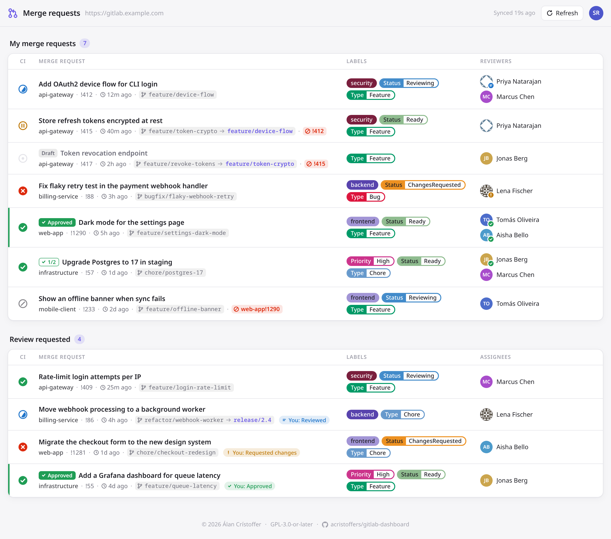

# gitlab-dashboard

**The merge requests that matter, on one page.**

<picture>
  <source media="(prefers-color-scheme: dark)" srcset="doc/screenshots/dashboard-dark.png">
  
</picture>

GitLab's built-in dashboards try to show everything. This one shows two lists,
and gives each row exactly what you need to decide what to do next:

1. **My merge requests**: everything you have open, and who's reviewing it.
2. **Review requested**: everything waiting on you, and whose it is.

## What you see at a glance

- **Pipeline status**: passed, failed, running and the rest, as a coloured icon
  that opens the pipeline.
- **Approval**: approved MRs stand out with a green **Approved** pill and a green
  edge. Hover to see who approved. MRs that need more approvals show progress
  like `1/2`.
- **Reviewers and assignees**: names and avatars, with a small badge showing who
  approved, who requested changes and who already reviewed.
- **Your own review**: on MRs you're reviewing, a reminder of where you left
  off, such as "You: Approved" or "You: Requested changes".
- **Labels**: GitLab's coloured pills, including split scoped labels like
  `Status | Ready`. They always appear in the same order, so you can scan them
  quickly.
- **Branches**: the MR's branch and, when it doesn't merge into the default
  branch, where it does: `feature/x → feature/base`. Handy for stacked MRs.
- **Blockers**: a red `⊘ !93` when an MR is waiting on another one to be merged.
- **Project and age**: the short project name, the MR number and when it was
  last updated.

Everything links straight to GitLab. The page refreshes itself every minute
while it's visible. Press `r` or click **Refresh** to update now. It follows
your system's light or dark theme and works on a phone too.

## Getting started

With Nix:

```sh
nix run github:acristoffers/gitlab-dashboard
```

Or with Go:

```sh
git clone https://github.com/acristoffers/gitlab-dashboard
cd gitlab-dashboard
go build -o gitlab-dashboard .
./gitlab-dashboard
```

Then open <http://127.0.0.1:8080>.

### Signing in to GitLab

If you use [`glab`](https://gitlab.com/gitlab-org/cli) and are logged in, there's
nothing to do: the dashboard uses its login.

Otherwise, create a personal access token with the `read_api` scope and put it
in `GITLAB_TOKEN`:

```sh
export GITLAB_TOKEN=glpat-…
```

The dashboard only reads from GitLab. It never changes anything.

### Using your own GitLab server

It talks to gitlab.com by default. To use a self-hosted GitLab:

```sh
./gitlab-dashboard -gitlab https://git.example.com
# or
export GITLAB_URL=https://git.example.com
```

## Configuration

| Option     | Environment variable | Default              | What it does                     |
|------------|----------------------|----------------------|----------------------------------|
| `-gitlab`  | `GITLAB_URL`         | `https://gitlab.com` | Which GitLab server to use       |
| `-listen`  | `DASHBOARD_LISTEN`   | `127.0.0.1:8080`     | Address the dashboard listens on |
| `-refresh` |                      | `60s`                | How often the page updates       |

Options given on the command line take priority over environment variables.

The dashboard uses your GitLab token, so by default only your own computer can
open it. Don't make it reachable from other machines unless you're comfortable
with everyone who can reach it seeing your merge requests.

## Troubleshooting

**Some avatars show initials instead of a picture.** GitLab only shows uploaded
profile pictures to a browser that is logged in to GitLab. Log in to GitLab in
the same browser.

In **Firefox**, you also need to allow it for the dashboard. Click the shield
icon in the address bar while on the dashboard and turn off Enhanced Tracking
Protection for that site. Firefox otherwise keeps your GitLab login separate
from other sites, so the pictures can't load. This affects only the dashboard.

## License

Copyright © 2026 Álan Crístoffer

This program is free software: you can redistribute it and/or modify it under
the terms of the GNU General Public License as published by the Free Software
Foundation, either version 3 of the License, or (at your option) any later
version. See [LICENSE](LICENSE).

How it works under the hood is described in [doc/design.md](doc/design.md).
